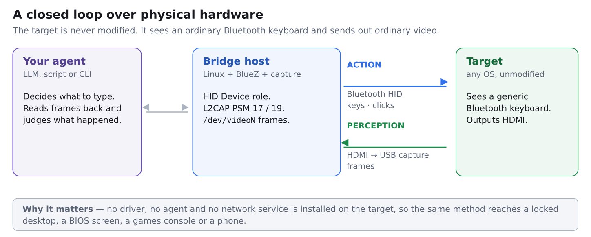
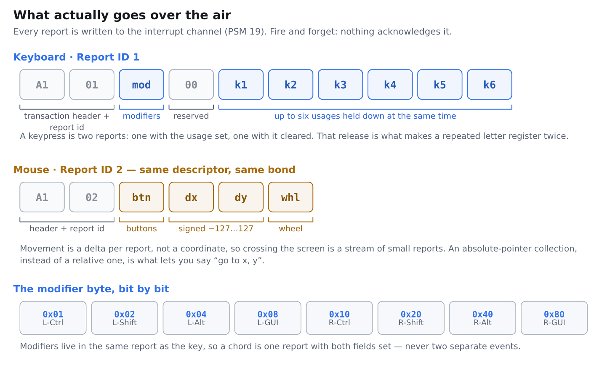
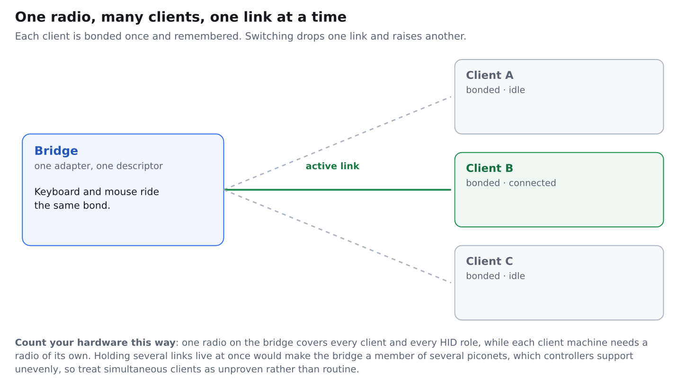

# physical-desktop-orchestration

Working notes for letting an automation agent operate a real computer the way a
person does: by typing on it and by looking at its screen.

Output goes out over Bluetooth as an ordinary HID keyboard. The screen comes
back through a capture stick as video frames. The computer being driven gets no
driver, no agent, no service and no account. It believes a keyboard is plugged
in, because as far as the radio is concerned, one is.

This repository is documentation first. It records what is hard to discover:
which system services fight you, what the bytes on the wire look like, where
the manual steps are, and how many radios you actually need. The code here is
illustrative. See [Bring your own AI](#bring-your-own-ai).

Search terms this covers: BlueZ HID device role, Linux as a Bluetooth keyboard,
Bluetooth HID emulation, L2CAP PSM 17 and 19, HID report descriptor, Class of
Device keyboard, HDMI capture with v4l2, agentic desktop automation, LLM
computer control without an agent installed, headless KVM over Bluetooth.

Jump to:
[What this is](#what-this-is) ·
[The shape of it](#the-shape-of-it) ·
[Is this for you](#is-this-for-you) ·
[Hardware](#hardware) ·
[Output half](#the-output-half-bluetooth-hid) ·
[Input half](#the-input-half-video-capture) ·
[More machines](#scaling-to-more-machines) ·
[Bridge setup](#preparing-the-bridge-host) ·
[Pairing](#pairing-the-one-manual-step) ·
[The scripts](#the-scripts) ·
[Bring your own AI](#bring-your-own-ai) ·
[Gotchas](#gotchas-that-cost-real-time) ·
[FAQ](#faq) ·
[Scope](#scope-and-non-goals) ·
[Glossary](#glossary) ·
[Disclaimer](#disclaimer) ·
[License](#license-and-citation)

---

## What this is

Most desktop automation assumes cooperation from the target: install an agent,
enable a remote protocol, open a port, log in. That assumption breaks on a lock
screen, in a firmware setup menu, on a games console, on a phone, on a machine
with no network, and on anything you are not allowed to install software on.

A Bluetooth keyboard needs none of that cooperation. It is accepted at a layer
far below the operating system's idea of users and sessions. Pair it once and
it can type, including into a locked machine, exactly as a physical keyboard
can. Put a video capture device at the other end and the loop closes, because
now the automation can see the consequence of what it typed.

The result is a general input and output channel to any machine with a radio
and a display output, built from two cheap parts and one Linux box.

## The shape of it



Three pieces are involved. Your agent is anything that can run a command and
look at a PNG, whether that is a shell script, a scheduled job, or a language
model with tool access. The bridge host is a Linux machine with a Bluetooth
radio and a USB capture input, which presents itself to the world as a keyboard
and holds the capture device. The target is any machine that accepts a
Bluetooth keyboard and emits video, and it is never modified.

## Is this for you

It fits well when you are driving a machine you own that cannot have software
installed on it, when you need to reach a device before its operating system is
up such as a firmware menu or boot picker, or when something has no API at all
and its only interface is a screen and a keyboard. It also suits testing how an
interface behaves under genuine keyboard input rather than synthetic events
injected inside the same OS, and teaching an agent to work from visual feedback
on real hardware.

Something simpler will serve better in these cases:

- Two machines you fully control on one network, where a software KVM or plain
  remote access is far less work.
- Anything needing file transfer, clipboard or audio, since this channel
  carries keystrokes and pointer motion only.
- High-rate or latency-critical input, because reports are small and
  unacknowledged and the capture path adds delay.
- Any situation where you lack authority over the target, as covered in the
  disclaimer below.

## Hardware

| Part | Role | Notes |
| --- | --- | --- |
| Linux machine | the bridge | Any machine with BlueZ. An internal radio is fine. |
| Bluetooth radio on the bridge | sends HID | One radio covers every client and both HID roles. |
| Bluetooth radio on each target | receives HID | Internal or a USB adapter. Targets cannot share one. |
| HDMI capture stick | returns the screen | Appears as a UVC webcam at `/dev/videoN`. |

Bluetooth version is rarely the constraint when choosing an adapter, because
classic HID is a profile from the 2.x era and needs only BR/EDR, while the low
energy variant needs only 4.0. Driver support follows the chipset instead of
the version printed on the box. Two patterns are worth knowing. Some popular
5.x adapters use a Realtek part that wants a firmware blob from
`linux-firmware`, which older kernels lacked. The classic CSR 4.0 adapters need
no firmware at all, which is why they became the standard advice, though
counterfeits of that part are widespread and report the same USB vendor and
product id as the genuine article. On a current kernel with current firmware
packages, both families generally work. Check `dmesg` after plugging one in.

## The output half: Bluetooth HID

Terminology first, because it inverts what people expect. In Bluetooth HID the
machine receiving input is called the host, and the keyboard is called the
device. So the Linux bridge takes the HID Device role and every machine it
drives is a HID Host. Searching for "bluetooth host" finds the opposite of
this.

A working device-role service does four things. It publishes an SDP record
describing itself, carrying the HID report descriptor. It listens on two L2CAP
ports, 17 for control and 19 for interrupt, both of which sit below 4096 and so
need privilege to bind. It registers a pairing agent so bonding can complete.
Then it writes reports to the interrupt channel whenever it wants something
typed.



A mouse is neither a second device nor a second radio. It is another collection
in the same report descriptor under a different report id, carried over the
same bond. The target then creates two input devices from one pairing. The same
trick extends to media keys or an absolute pointer.

One ordering decision saves real pain: settle the descriptor before you pair
anything. Targets cache the report descriptor per bonded device, so adding the
mouse later usually means removing and re-pairing on every client, and pairing
is the step you cannot automate.

The keyboard descriptor below is the conventional boot-protocol layout with a
report id added. Each line is one item, and the comment names what it declares:

```
05 01       Usage Page (Generic Desktop)
09 06       Usage (Keyboard)
A1 01       Collection (Application)
85 01         Report ID (1)
05 07         Usage Page (Keyboard / Keypad)
19 E0         Usage Minimum (Left Control)
29 E7         Usage Maximum (Right GUI)
15 00         Logical Minimum (0)
25 01         Logical Maximum (1)
75 01         Report Size (1)
95 08         Report Count (8)
81 02         Input (Data, Variable, Absolute)    the modifier byte
95 01         Report Count (1)
75 08         Report Size (8)
81 01         Input (Constant)                    the reserved byte
95 05         Report Count (5)
75 01         Report Size (1)
05 08         Usage Page (LEDs)
19 01         Usage Minimum (Num Lock)
29 05         Usage Maximum (Kana)
91 02         Output (Data, Variable, Absolute)   host to device, lock lamps
95 01         Report Count (1)
75 03         Report Size (3)
91 01         Output (Constant)                   padding for the lamp byte
95 06         Report Count (6)
75 08         Report Size (8)
15 00         Logical Minimum (0)
25 65         Logical Maximum (101)
05 07         Usage Page (Keyboard / Keypad)
19 00         Usage Minimum (0)
29 65         Usage Maximum (101)
81 00         Input (Data, Array)                 the six key slots
C0          End Collection
```

Appending a second collection turns the same service into a keyboard and a
mouse sharing one bond. It opens the same way, with a Generic Desktop usage
page, a Mouse usage, an application collection and `85 02` for the report id,
then wraps a physical collection around these fields:

| Fields | Items | Produces |
| --- | --- | --- |
| Buttons 1 to 3 | Button usage page, usages 1 through 3, one bit each | the three button bits |
| Padding | five constant bits | fills the byte out |
| X, Y, Wheel | usages `09 30`, `09 31`, `09 38`, eight bits each, range −127 to 127, flagged Relative | the three movement bytes |

Two `C0` items close the physical and application collections. The only
structural difference from the keyboard is that final Relative flag, which is
what makes the values deltas instead of positions.

The SDP record wrapping that descriptor needs a handful of attributes to be
taken seriously by a client: the Human Interface Device service class, a
protocol list naming L2CAP port 17 followed by HIDP, an additional protocol
list naming port 19, the descriptor itself, and the booleans describing what
kind of keyboard this claims to be. Getting a boolean or an attribute id wrong
tends to produce a device that pairs and then does nothing, so check the record
parses before blaming the radio.

## The input half: video capture

A capture stick presents as a standard UVC camera, so no special software is
needed to read it. A single frame grab is enough for most agent work:

```sh
ffmpeg -nostdin -f v4l2 -input_format mjpeg -video_size 1920x1080 \
       -i /dev/videoN -vf "select=gte(n\,30)" -frames:v 1 -update 1 \
       shot.png
```

Three details in that command matter. Skipping ahead about thirty frames lets
the device stabilise, since the first frames after opening it are often
malformed. The `-update 1` flag tells the image muxer that a single file is
intended, which suppresses a confusing warning about sequence patterns. Passing
`-nostdin` keeps ffmpeg from swallowing the standard input of whatever invoked
it, which matters when it runs inside a script or over a pipe.

What comes back is a picture of a screen, which is exactly as much as a person
sitting there would have. That suffices to confirm a keystroke landed, to read
a dialog, or to decide what to type next. It will not give you reliable text
without OCR, and it says nothing about state that was never drawn.

Find the input and its capabilities before grabbing from it, because one stick
often exposes several device nodes while only some of them deliver frames:

```sh
v4l2-ctl --list-devices
v4l2-ctl -d /dev/videoN --list-formats-ext
```

Ask for a format the hardware produces natively. Many sticks offer MJPEG at the
full frame rate and uncompressed YUV only at a far lower one, so an unlucky
combination of format and resolution quietly drops you to a few frames per
second. If a grab returns errors mentioning absent JPEG data, that is usually
the stabilisation problem rather than a broken device, and skipping more frames
fixes it. If the picture is black, check that the source is actually outputting
and that nothing upstream is refusing to send protected content.

## Scaling to more machines



The counting rule is short. One radio on the bridge serves every client and
every HID role you add. Every target needs a radio of its own, because radios
cannot be shared between machines. Extra adapters on the bridge buy nothing in
the usual case, and they do not escape the daemon-wide setting described next.

## Preparing the bridge host

Three changes live outside your program, in system configuration. They survive
your code and they are the usual reason a first attempt fails.

| Change | Why it is needed | Symptom if skipped |
| --- | --- | --- |
| Run the Bluetooth daemon without its `input` plugin | That plugin claims L2CAP ports 17 and 19 for the receiving role | Your sockets never bind, and the error names the port instead of the plugin holding it |
| Run it without the `hostname` plugin | That plugin derives the adapter name and class from the chassis and silently overrides configuration | Your class and name are ignored and the adapter keeps announcing itself as a laptop |
| Set Class of Device to the Peripheral major class with the keyboard minor bit | It is how clients decide to offer pairing as an input device | Clients may refuse to pair or file it under the wrong category |

The trade-off is worth stating plainly, because it lasts as long as the service
runs. Disabling the `input` plugin applies to the whole daemon instead of one
adapter, so the bridge gives up using Bluetooth keyboards and mice of its own.
Audio profiles are unaffected. A second radio does not win the exemption back.

Concretely, on a systemd distribution the daemon flags belong in a drop-in,
because editing the unit itself gets overwritten on upgrade:

```ini
# systemctl edit bluetooth
[Service]
ExecStart=
ExecStart=/usr/libexec/bluetooth/bluetoothd --noplugin=input,hostname
```

That binary path differs between distributions, so copy it from the existing
`ExecStart` line rather than from here. Adapter identity lives in the main
configuration file:

```ini
# /etc/bluetooth/main.conf
[General]
Class = 0x000540
Name = ExampleKbdBridge
DiscoverableTimeout = 180
```

Then confirm what the controller actually advertises, since this is the step
that fails silently while the `hostname` plugin is still loaded:

```sh
sudo btmgmt info
```

A class whose major field reads Peripheral with the keyboard minor bit is what
you want. One that still reads Computer means something overrode the
configuration. The controller merges service bits of its own into the value, so
the number reported back will be longer than the number you set.

## Pairing, the one manual step

Expect to pair each client by hand, once, through that operating system's own
Bluetooth settings. On at least some desktop platforms the Secure Simple
Pairing confirmation is reserved for the system's own dialog, so no outside
process can answer it regardless of privilege. Budget one short manual action
per client and no more. After bonding, reconnection needs no consent at all,
which is precisely how a real keyboard wakes a sleeping machine.

## The scripts

Demonstration implementations of everything above. Each is parameterised by
environment variable and carries no machine-specific values.

| Path | What it does |
| --- | --- |
| `src/hid_bridge.py` | The service. Registers the HID record, serves both L2CAP ports, answers pairing, and turns control-FIFO lines into keyboard and pointer reports. |
| `scripts/setup-bridge.sh` | Applies the three system changes, taking a backup and prompting first, then prints the adapter class so you can check it. |
| `scripts/pair-window.sh` | Opens a timed pairing window and closes it again on exit. |
| `scripts/hid-send.sh` | Writes one command into the control FIFO. |
| `scripts/capture.sh` | Grabs a single frame using the flags explained earlier. |
| `scripts/capture-probe.sh` | Lists capture nodes and the formats each one supports. |

A first run looks roughly like this:

```sh
sudo ./scripts/setup-bridge.sh        # once per bridge host, and it is invasive
sudo python3 src/hid_bridge.py &      # root, because the HID ports are privileged
./scripts/pair-window.sh 120          # then confirm on the client, by hand
./scripts/hid-send.sh status
./scripts/hid-send.sh type "hello."
./scripts/capture.sh shot.png         # look at what actually happened
```

Status worth stating plainly, since it affects how much you should trust these
files. The report descriptor parses to a balanced structure declaring report
ids 1 and 2, the SDP record is well-formed and carries that descriptor with
both port numbers, and the shell scripts are syntax-checked with their refusal
paths exercised. The combined keyboard and mouse build has not been run against
real hardware, so treat the pointer collection in particular as the part most
likely to need debugging on first contact.

## Bring your own AI

The code here is a reference rather than a product. Everything genuinely hard
to rediscover is written down: the report descriptor shape, the daemon flags,
the port numbers, the pairing boundary, the capture invocation. The scripts
show one way of assembling those parts.

Every environment differs in distribution, init system, device paths,
permissions and desired control protocol, so expect to adapt rather than
install. A coding agent given this document and these files can fit them to
your machine quickly, and that will serve you better than anything shipped here
could.

Suggested prompt shape: give your agent this README plus `src/hid_bridge.py`,
state your distribution and how you want to drive it, then ask for the changes
your setup needs. Review what it writes before running it with privilege,
because this component types into your computers.

## Gotchas that cost real time

| What bites | What to do about it |
| --- | --- |
| The pairing confirmation cannot be supplied by your own code on some platforms | Treat it as a manual step and stop fighting it |
| Report descriptors are cached per bond | Finalise the descriptor first, or expect to re-pair |
| Classic HID ports are privileged | Run the service as root or grant an equivalent capability |
| A monitoring tool writing to standard output may be block buffered | Write to a file and read it back, so an empty capture is not misread |
| Clients cache inquiry results including the remote name | Cycle the client's radio after renaming the adapter |
| Process-matching patterns such as `pkill -f` can match the shell running them | Anchor the pattern |
| Some tools stay silent unless a compatibility mode is enabled | Do not read their silence as evidence of a missing record |
| The first frames from a capture device are frequently malformed | Skip a number of frames before grabbing one |
| A keystroke is two reports, press and release | Send both, or repeated letters vanish |
| Reports are unacknowledged | Verify through the capture path rather than assuming delivery |

## FAQ

### Does the target know it is not a real keyboard?

At the HID layer there is nothing to distinguish them. The report stream is
what a keyboard sends.

### Will this type into a locked machine?

Yes, once bonded. That is normal keyboard behaviour, and it is also why the
bridge needs protecting.

### Can it work without pairing?

No. Bonding is the security boundary and that is deliberate.

### Does it need the network?

No. The Bluetooth link and the video cable carry everything. How you reach the
bridge is your own business and is out of scope here.

### Can one bridge drive several machines at once?

It can be bonded to many and connected to one at a time comfortably. Several
simultaneous links are possible in principle but depend on controller support
that varies, so treat that as unproven.

### Can it read the screen reliably?

It returns pixels. Turning pixels into text needs OCR, with the usual accuracy
caveats.

### Does it work with a phone or a console?

If the device accepts a Bluetooth keyboard and outputs video, the same method
applies. Some devices restrict video output.

### Why not just use remote desktop software?

If you can install and run it, do. This approach exists for cases where you
cannot, or where you specifically want input to arrive as real hardware.

## Scope and non-goals

In scope: the Bluetooth HID device role under BlueZ, HID report descriptors and
report formats, video capture as a feedback channel, pairing and bonding
behaviour, hardware selection, and the failure modes of all of that.

Deliberately out of scope:

| Not covered | Why |
| --- | --- |
| Networking and remote access | How an operator reaches the bridge is a local decision with no bearing on the method. Any such arrangement in the author's own setup is incidental and forms no required layer. |
| A finished product | There is no installer and no daemon to deploy. |
| Hardening your particular deployment | General cautions are in the disclaimer; your threat model is yours. |
| Vendor recommendations | Hardware is described by category and behaviour. |

## Glossary

| Term | Meaning |
| --- | --- |
| HID Device | The thing that sends input. The bridge takes this role. |
| HID Host | The thing that receives input, meaning the machine being driven. |
| L2CAP | The Bluetooth transport layer carrying HID. Ports 17 and 19. |
| SDP | The service record a device publishes so clients learn what it is. |
| Report descriptor | The declaration of what reports look like and what they mean. |
| Report id | The tag that lets one descriptor carry a keyboard and a mouse. |
| Class of Device | A coarse category clients use to decide how to present a device. |
| Bond | Stored pairing keys, letting later connections proceed without consent. |
| SSP | Secure Simple Pairing, the modern pairing exchange. |
| UVC | The USB video class, which makes a capture stick act like a webcam. |
| Usage | A numeric code for one key or control in the HID tables. |

## Disclaimer

Everything here exists to explain a technique. It is not a supported tool, it
has no installer, it has had no security review, and it is not fit for
production or for any setting where failure carries cost. Nothing is tested
across distributions, kernel versions, Bluetooth stacks or hardware beyond the
incidental configuration it was written from. The material is provided as is,
without warranty of any kind, express or implied, including the warranties of
merchantability, fitness for a particular purpose and non-infringement. In no
event shall the authors or copyright holders be liable for any claim, damages
or other liability, whether in an action of contract, tort or otherwise,
arising from, out of or in connection with the material or its use. The licence
texts govern, and this paragraph restates their intent without replacing them.

Use this only on equipment you own, or that you have explicit permission to
operate. Pairing a keyboard to a machine and typing into it is an act of
control over that machine, and doing so without authority may be unlawful where
you live. Three properties deserve emphasis because the method is quiet by
nature: input arrives as genuine hardware input and so will not appear in logs
that record remote access; it works against a locked session once bonded, which
is ordinary keyboard behaviour rather than a flaw; and it leaves the target
unmodified, so there is nothing on it to review afterwards. Real keyboards
behave the same way, which is exactly why authorisation matters more here than
usual. This technique is documented for automating systems under your own
control, and adapting it for access to systems you do not administer falls
outside what this repository supports.

Anything able to command the bridge can type into every machine bonded to it,
which makes the bridge about as sensitive as the keyboards on your desk and
deserving of the same physical and administrative care. A service that accepts
instructions from elsewhere widens that boundary to everything able to reach
it. Bonding is the security boundary of the link, so keep discoverable and
pairable modes switched off except during the moments you are deliberately
pairing something, and remove bonds you no longer want. Remember too that an
agent typing blind into whatever window holds focus can do anything a person
could, including deleting data, confirming dialogs and running commands, so
look at the screen before sending input, prefer targets you can afford to lose
while developing, and build in a way to stop.

A capture device sees everything the display shows, including credentials,
personal data, and the content of other people's accounts and messages, so
store and transmit those frames accordingly and consider the privacy of anyone
whose information may appear. Some video sources restrict copying by design,
and attempting to defeat such restrictions may be unlawful. Bluetooth hardware
operates under the radio rules of your jurisdiction, which govern what
equipment may be used and how it may be modified, so use equipment approved for
your region and leave its radio behaviour alone.

Every address, hostname, device name, numeric id, passkey and path appearing in
this document is illustrative. They refer to no real device and no real person,
and none of them should be reused as configuration. Replace them with values
from your own environment. Because this repository encourages using a coding
agent to scaffold an implementation, one further caution applies: code produced
that way can be wrong in ways that are hard to see, and the component under
discussion runs with privilege and types into your computers, so read it before
you run it and test it somewhere disconnected first. The projects, protocols,
chipsets, operating systems and product categories mentioned are named for
identification only, with no endorsement, affiliation or sponsorship implied in
either direction and no trademark claim made.

## License and citation

Copyright (c) 2026 Aesthetic Vulpes ([github.com/didvc](https://github.com/didvc)).

Code and configuration samples are under the MIT license, in [LICENSE](LICENSE).
Prose, figures and documentation are under Creative Commons Attribution 4.0
International, in [LICENSE-CC](LICENSE-CC).

If you reference this work, citation metadata is in
[CITATION.cff](CITATION.cff).
